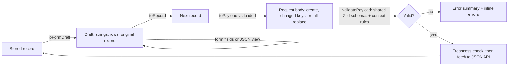

# Admin forms

**Status:** In Progress
**Owner:** Jared B.
**Last updated:** 2026-11-14
**Related:** [Timed actions spec](2026-11-timed-actions.md); research notes summarised in [Appendix D](#d-references)

---

## 1. Overview / business context

### 1.1 Problem statement

1. Editors create and edit projects, goals and actions by typing JSON. They must remember field names, quoting, date formats and the ids of other records, and a mistake surfaces only as a server error naming one field at a time.
2. The editor gives no help with relationships. Attaching an action to a goal, or a project to a goal, means copying an id from another tab.
3. The editor loses work without warning. Selecting another record or pressing Refresh replaces unsaved text.
4. The editor is not accessible. The text area has no label, the tabs have no keyboard support, and errors are announced only as one status line.
5. Two defects exist independently of how records are edited: organisation and source link fields accept `javascript:` and `data:` addresses that the public page renders as links, and the colors available for error text, input borders and focus rings fail WCAG 2.1 AA on the admin panel.

**Spec category:** Feature. It replaces how three existing content types are edited; storage and the public pages do not change.

### 1.2 Business / customer outcome

- **Editors** (two non-developers) can create and edit any record without knowing JSON, and cannot lose unsaved work by accident.
- **Visitors** are unaffected, except that unsafe link schemes can no longer be published.
- **Success is measured by:** every field that renders publicly being editable through a form; no existing record changed by opening and saving it untouched; and no way to leave a dirty record without a prompt.

### 1.3 Dependencies & assumptions

- **Depends on:** nothing external.
- **Assumes:** two trusted editors behind Cloudflare Access; JavaScript is required (as it is today); the public JSON API keeps its current semantics.
- **Risks if wrong:** if editors need offline or no-JavaScript editing, the transport choice in [4.1](#41-summary) has to be revisited.

### 1.4 Tenets / constraints

- **A form is a lossless view of the stored record.** Opening a record and saving it untouched changes nothing, including fields the form does not show.
- **The server stays the authority.** The browser validates with the server's own rules to give early feedback; it never replaces server validation.
- **The API does not change.** No route, request shape or response shape changes. One validation rule is tightened ([4.3.1](#431-link-field-hardening)).
- **No new dependencies and no experimental framework features.**
- **A save sends only what the editor changed.** There is no version check between the two editors, so the blast radius of each save is kept small.
- **Nothing publishes by accident.** There is no autosave; every write is an explicit Save.

---

## 2. Goals

**Goal 1 — Edit by form**
As an editor, I want labelled fields, pickers and add/remove rows for every part of a project, goal or action, so that I never type JSON for ordinary edits.
**Success signal:** each record type can be created, edited, archived and restored end to end without opening the JSON view.

**Goal 2 — Relationships without ids**
As an editor, I want to pick a goal or project from a list and to start an action from its goal, so that I never copy an id between tabs.
**Success signal:** an action created from a goal's "Add an action" button is attached to that goal with no typing.

**Goal 3 — No lost work**
As an editor, I want to be asked before unsaved changes are discarded, so that a stray click does not cost me my edits.
**Success signal:** every way of leaving a changed record prompts first.

**Goal 4 — Clear, accessible errors**
As an editor, including one using a keyboard or screen reader, I want every problem listed at once in plain words and linked to its field.
**Success signal:** a failed Save moves focus to a summary that links to each faulty field; the forms meet WCAG 2.1 AA.

**Goal 5 — Nothing becomes impossible**
As the site owner, I want a raw view kept for the rare edit a form cannot express.
**Success signal:** any stored record can still be viewed and edited as JSON, with warnings where the API would ignore an edit.

---

## 3. Out of scope

- **Changing API semantics.** Project and goal updates stay a shallow merge, so a top-level field still cannot be removed once set. The forms explain this; they do not fix it.
- **A version check or locking between editors.** A pre-save freshness warning is in scope; real conflict detection needs an API change.
- **Recovering a draft after the sign-in session expires.** The page says what happened and offers the draft as text to copy.
- **Removing the stray misspelled key on the goal `regional-amtrak-intercity-rail`.** The API cannot delete it; it needs a direct database edit approved separately.
- **A registry of organisations, drag-and-drop reordering, rich text, image upload, bulk edits.**
- **Changing the public pages**, other than what tighter link validation prevents.
- **A forms library, SvelteKit remote functions or form actions.** See [Appendix A](#a-alternatives-considered).

---

## 4. Proposed solution

### 4.1 Summary

Three hand-built forms from native HTML controls replace the JSON text area as the default editor; the JSON text stays as an "advanced" second view of the same draft. Each open record is held as one draft that keeps the original record underneath, and three pure functions convert record to draft, draft to record, and record to request body. A test proves the round trip is lossless for a copy of every live record. The browser validates the exact body it will send with the server's own Zod schemas, moved to a module both sides can import. Saves go through the existing JSON API with `fetch`. This beats a forms library or framework form handling because the API already exists, the page already requires JavaScript, and the hard part is losslessness and guarded writes, which no library provides.

### 4.2 Diagram

### 4.3 Component designs

#### 4.3.1 Link field hardening

**Responsibility:** stop unsafe link schemes from being stored.

**Interfaces:** `organizationRefSchema`, `relatedOrgSchema` and `contentSourceSchema` in the content schemas.

**Callouts:**

- **`url` in those three schemas becomes http(s)-only** (`z.httpUrl()`), matching timed-action links. Today `z.string().url()` accepts `javascript:alert(1)` and `data:` URLs, and the public page renders them as `href`.
- **This tightens validation on existing routes.** Every URL in the live data is `https`, so no stored record is affected, but it is a behavior change on the published API and needs the owner's approval.
- **Seeding uses the same schemas.** Confirm the seed files still load.

**Open questions:** none. The owner authorised this plan, including tightening these three URL fields, on 2026-11-14.

#### 4.3.2 Shared schemas and option lists

**Responsibility:** make the server's validation rules and the editor's fixed lists importable by the browser.

**Interfaces:** new `src/lib/content/schemas.ts` and `src/lib/content/options.ts`; `src/lib/server/content/validators.ts` re-exports the schemas.

**Callouts:**

- **Move, do not copy.** The pure schemas, `ID_PATTERN`, the length limits, `TIMED_ACTION_MAX_DAYS_AHEAD`, `hasNoCredentials`, `addDays` and a pure `timedActionWindowError(expiresOn, today, previousExpiresOn?)` move to `schemas.ts`. `validators.ts` keeps everything that touches seed JSON or `ContentStoreError` and re-exports the rest, so server call sites, tests and the OpenAPI document do not change.
- **`schemas.ts` must import nothing from `src/lib/server/`.** SvelteKit blocks server modules from browser code, but Vitest does not, so a test asserts it.
- **Option lists:** `PROJECT_STATUSES` (the six existing statuses, from `statusHelpers.ts`), `GEO_SCOPES` (`corridor`, `regional`, `county`, `local`), `PROJECT_MODES` (`transit`, `bus`, `rail`, `road`, `bike`, `walk`, `multi-modal`), each with labels. The server still accepts any string; the lists drive the controls.
- **Bundle cost:** about 23 KB gzipped of Zod on the admin route only, measured on a synthetic build. Measure the real build in this ticket and confirm no public route's chunk includes Zod.

**Open questions:** none.

#### 4.3.3 Form model

**Responsibility:** convert between stored records, editable drafts and request bodies without losing data, and report problems by field.

**Interfaces:** pure TypeScript in `src/lib/content/formModel/`; no Svelte, no network.

- **`toFormDraft(kind, record)`** turns every editable value into a string, or a row of strings with a client key, and keeps the original record as `base` and each row's original item.
- **`toRecord(draft)`** spreads `base`, then writes the known fields. A known field that is absent from `base` and blank in the draft stays absent. An optional value inside a row that is blank is omitted, unless the stored value was already an empty string.
- **`toPayload(kind, mode, next, loaded)`** strips server-managed keys and builds the body: the whole record on create; only the changed top-level keys for a project or goal update; the five-field body for a timed action. It also reports top-level keys the editor removed, which the API cannot remove.
- **`validatePayload(kind, mode, body, context)`** runs the same schema the server applies to that request, then the rules that need context, and returns `{ path, message }` issues with editor-facing wording.
- **`parseServerError(status, body, url)`** turns an API error into a message and, when it names a field, an issue.

**Callouts:**

- **Round-trip identity is the acceptance test:** `toRecord(toFormDraft(kind, r))` deep-equals `r` for a fixture copy of every live record (personal values anonymised).
- **Never write Zod's parse output back into the draft.** It trims strings and reorders keys.
- **Context rules, outside the schema:** the expiry window against today's date in Atlanta (only when the date changed on an edit); the goal exists and is active; a new id is not already used, including by archived records; a stored lead organisation or geographic scope cannot be blanked.
- **Messages are mapped in the browser** from the issue code and the field's label ("Enter a title", "Description must be 300 characters or fewer", "Source 2: enter a full web address starting with https://"). The server's message text does not change.
- **Server errors:** read `message`, falling back to `error` (the 403 and 429 bodies use `error` and currently show as raw JSON); find the field with the existing `"… validation failed - <path>: <message>"` format; map 409 "already exists" to the id field.

**Open questions:** none.

#### 4.3.4 Editor pane and safe writes

**Responsibility:** own the open record's draft, its two views, validation and the guards around writes.

**Interfaces:** `src/components/svelte/admin/EditorPane.svelte`, used by `src/routes/admin/+page.svelte`, which keeps the lists, network calls and messages.

**Callouts:**

- **Behaviors kept exactly:** create versus update by whether a record is selected; the placeholder rule for tab switches; client-chosen ids for projects and goals and server-generated ids for actions; archive and restore through their own endpoints; upsert, quiet reload and reselect after every write; the existing messages, including "Saved, but … could not be reloaded" and "Saved. This action is still archived; restore it to publish."
- **Dirty means the request body would be non-empty,** not "a key was pressed".
- **A clean Save sends nothing** and says "No changes to save."
- **Every exit from a dirty record asks first:** selecting another record or a Recent Changes entry, "+ New", Close, Refresh, "Add an action for this goal", in-app navigation and closing the tab. The prompt names the record and offers "Discard changes" and "Keep editing".
- **Confirmations use a native `<dialog>`,** not `window.confirm`. Archive confirms and states the consequence (a goal's actions leave the site; a project drops out of the goals that link to it). Restore does not confirm.
- **Freshness check before an update:** fetch the record; if its `provenance.updated_at` differs from the loaded copy, say who changed it and when and ask before saving.
- **Validation runs on Save.** A failed Save shows a summary titled "There is a problem", moves focus to it, and marks each field. An error clears as soon as its value becomes valid; new errors appear only on the next Save.
- **The Save button is never disabled.** While a save is in flight it reads "Saving…" and ignores repeat clicks.
- **A network failure with no response** is reported as "Could not reach the server. Your sign-in may have expired." with the draft left in place.
- **Record-type tabs gain arrow, Home and End keys** with a roving `tabindex`.

**Open questions:** none.

#### 4.3.5 JSON view

**Responsibility:** keep a general editor for what the forms cannot express.

**Interfaces:** a second view inside the editor pane, reached by a button ("Edit as JSON (advanced)" / "Back to form"), not a tab.

**Callouts:**

- **One draft, two views.** The text shows the record without `id`, `provenance` and the archive fields, which appear read-only above it.
- **Text is committed only when it parses.** Returning to the form is blocked while the text does not parse, or while a field the form shows holds the wrong type; the message says which.
- **A `__proto__` key is rejected.**
- **Warnings where the API would ignore or keep an edit:** deleting a top-level key of a project or goal ("can't be removed through the API; it will keep its stored value"); adding a key the form does not know (it will be stored, shown nowhere, and cannot be removed later; ask first). Unknown keys on a timed action are an error.
- **When a record has fields the form does not show,** the form says so and names them.

**Open questions:** none. The owner authorised this plan with the JSON view kept editable on 2026-11-14.

#### 4.3.6 Form controls

**Responsibility:** accessible building blocks shared by the three forms.

**Interfaces:** `FormField`, `CheckboxGroup`, `RepeatableRows`, `ErrorSummary`, `ConfirmDialog` in `src/components/svelte/admin/`; three new tokens in `src/styles/global.css`.

**Callouts:**

- **Layout:** one column, labels above inputs, hints as persistent text (never placeholders), the primary button left-aligned at the end. No sticky bar.
- **Required marking:** the word "(required)" in the label, with one line at the top of each form explaining it. No asterisks and no HTML `required`; forms set `novalidate`.
- **Fields:** a real `<label for>`; hint and error linked with `aria-describedby`; `aria-invalid` only while in error; control ids built from the field path (`project-sources-1-url`) so summary links can target them.
- **Character counters** only on the action description (300), link and location labels (40) and address (200). Soft limit, no `maxlength`; counts `value.trim().length`; announced politely after a pause, not on every keystroke.
- **Repeatable rows:** each row a `fieldset` with a numbered legend and a remove button named for the row; adding focuses the new row's first field; removing focuses the previous row or the add button; changes announced politely. Only sources can be reordered (move up, move down), because the public card links the first source.
- **Choices:** checkbox groups for counties, modes and related projects; native `select` for status, geographic scope and goal. A stored value outside a list is kept and shown as an extra option.
- **Dates:** native `type="date"`, kept as a `YYYY-MM-DD` string end to end. A stored value that is not a date falls back to a text input.
- **Optional link and location:** always-visible fieldsets, "both fields or neither".
- **Tokens:** `--danger-text: #f0b8b3`, `--field-border: #9fa7a2`, `--focus-ring: #7dd3fc`, documented in `docs/design-tokens.md`. The existing red, blue and border tokens measure 1.68:1, 2.61:1 and at most 1.52:1 on the admin panel, below the 4.5:1 and 3:1 that WCAG 2.1 AA requires. Errors also carry the word "Error", never color alone.

**Open questions:** none. The owner authorised this plan, including the three new tokens, on 2026-11-14.

#### 4.3.7 The three forms

**Responsibility:** lay out each record type's fields.

**Interfaces:** `TimedActionFields`, `GoalFields`, `ProjectFields` in `src/components/svelte/admin/`.

| Form    | Sections and fields                                                                                                                                                                                                                                                                                                                                                                                        |
| ------- | ---------------------------------------------------------------------------------------------------------------------------------------------------------------------------------------------------------------------------------------------------------------------------------------------------------------------------------------------------------------------------------------------------------- |
| Action  | Goal (select of active goals; the current goal always present), description (counter), last day (date, with the allowed window in the hint), link (label, web address), location (label, address)                                                                                                                                                                                                          |
| Goal    | **Goal:** id (create only), goal text, counties ("leave all unticked to list under Regional"). **Progress:** status text (hint: web addresses become links), ongoing actions. **Links:** related projects (active first, archived under their own heading, unknown ids kept and labelled), related organisations (name, web address, contact info), this goal's actions with "Add an action for this goal" |
| Project | **Basics:** id (create only), title, status (with a live badge), summary. **Dates and milestones:** start, end, milestones (title, date). **Where and how:** geographic scope, counties, modes. **Organisations:** lead (name, web address), partners. **Sources:** label, web address, last verified; reorderable                                                                                         |

**Callouts:**

- **"Add an action for this goal"** is offered only for a saved, active goal, and otherwise says why not. It opens the action form with the goal preselected and changeable. After the action is created the editor shows it, with a "Back to goal" button.
- **A project's or goal's id is read-only after creation.**
- **Fields the API cannot clear** (lead organisation, geographic scope) say so in their hint once they hold a value.
- **Order of delivery:** actions first (five fields, newest editors' task), then goals, then projects.

**Open questions:** none.

---

## 5. Implementation plan

Tickets are in dependency order; each is one pull request, mergeable and deployable alone.

### Ticket 1 — Accept only http(s) links for organisations and sources

**User Story:**
As a visitor, I need published links to be ordinary web links so that a link on the site cannot run script.

**Acceptance Criteria (checkbox-ready):**

- **Validation**
  - [ ] Creating or updating a project or goal with an organisation or source `url` of `javascript:alert(1)` or `data:text/html,x` returns 400 naming the field
  - [ ] `https://` and `http://` URLs are accepted as before
  - [ ] The seed data still loads

**Callouts:** `src/lib/server/content/validators.ts` (`organizationRefSchema`, `relatedOrgSchema`, `contentSourceSchema`).

**Rollout:**
**Test plan:** validator unit tests for the three schemas; smoke and integration scripts.
**Legacy / migration handling:** none; all live URLs are `https`.

**Definition of done:** `npm run ci:gate:full` passes.
**Rollback / feature flag:** revert the PR.

### Ticket 2 — Shared schemas and option lists

**User Story:**
As a contributor, I need the validation rules in a module the browser can import so that the editor and the server cannot drift apart.

**Acceptance Criteria (checkbox-ready):**

- [ ] `src/lib/content/schemas.ts` holds the pure schemas and helpers; `validators.ts` re-exports the same objects
- [ ] A test fails if `schemas.ts` imports from `src/lib/server/`
- [ ] `PROJECT_STATUSES`, `GEO_SCOPES` and `PROJECT_MODES` exist with labels, and the status helpers and the project modal use them
- [ ] No server behavior, error text or OpenAPI output changes
- [ ] The built public home page loads no chunk containing Zod

**Callouts:** `src/lib/content/`, `src/lib/server/content/validators.ts`, `src/utils/statusHelpers.ts`, `src/components/svelte/ProjectDetailModal.svelte`.

**Rollout:**
**Test plan:** existing validator, handler and OpenAPI tests unchanged and green; a parity test; a build-output check.
**Legacy / migration handling:** none.

**Definition of done:** `npm run ci:gate:full` passes; bundle sizes recorded in the PR.
**Rollback / feature flag:** revert the PR.

### Ticket 3 — Form model

**User Story:**
As an editor, I need the editor to carry every part of a record through an edit so that saving never drops or alters something I did not touch.

**Acceptance Criteria (checkbox-ready):**

- [ ] `toRecord(toFormDraft(kind, r))` deep-equals `r` for a fixture copy of every live project, goal and action
- [ ] An untouched record produces an empty update body
- [ ] A project or goal update body contains only the changed top-level keys; a timed-action body always has exactly its five fields
- [ ] A blank optional URL is omitted; an all-blank link or location becomes `null`; client row keys never reach a body
- [ ] `validatePayload` returns every problem at once, keyed by field path, in editor-facing words
- [ ] `parseServerError` handles 400 with a field path, 409, and bodies that use `error`

**Callouts:** `src/lib/content/formModel/`; fixtures under `src/lib/content/formModel/fixtures/` with editor identities replaced by `editor`.

**Rollout:**
**Test plan:** pure unit tests only.
**Legacy / migration handling:** none.

**Definition of done:** `npm run ci:gate` passes; no UI change.
**Rollback / feature flag:** revert the PR; nothing uses the module yet.

### Ticket 4 — Editor pane and safe writes

**User Story:**
As an editor, I need to be asked before losing changes, and I need saves that send only what I changed, so that a stray click or a colleague's edit does not cost work.

**Acceptance Criteria (checkbox-ready):**

- [ ] The editor still edits JSON text for every type, now through the draft and the form model
- [ ] Every exit from a changed record prompts with "Discard changes" and "Keep editing"
- [ ] Archive confirms in a dialog that states the consequence; Restore does not confirm; `window.confirm` is gone
- [ ] A clean Save sends nothing and says "No changes to save."
- [ ] A project or goal Save sends only changed keys; deleting a top-level key in the text warns that it cannot be removed
- [ ] An update whose record changed on the server since it was opened asks before saving
- [ ] 403 and 429 errors show their message, not raw JSON
- [ ] The record-type tabs work with arrow, Home and End keys

**Callouts:** `src/routes/admin/+page.svelte` shrinks; new `EditorPane`, `JsonView`, `ConfirmDialog`; `page.svelte.test.ts` is rewritten (its six tests drive an unlabelled text area and two expect a write from an unedited record).

**Rollout:**
**Test plan:** page-level tests with `fetch` stubbed, asserting whole request bodies; dialog tests with `showModal`/`close` stubbed (jsdom lacks them); a browser click-through on a local Worker.
**Legacy / migration handling:** none.

**Definition of done:** `npm run ci:gate` passes; click-through recorded in the PR.
**Rollback / feature flag:** revert the PR.

### Ticket 5 — Form controls and the action form

**User Story:**
As an editor, I need to create and edit an action by filling in fields so that I never type JSON or copy a goal id.

**Acceptance Criteria (checkbox-ready):**

- [ ] The action editor opens as a form; the JSON view is one button away and edits the same draft
- [ ] The goal is chosen from a list of active goals
- [ ] Counters show on description, both labels and address
- [ ] A failed Save lists every problem, focuses the summary and links to each field
- [ ] The three tokens exist and are documented; error text, input borders and focus rings meet 4.5:1 and 3:1

**Callouts:** `FormField`, `ErrorSummary`, `TimedActionFields`; `src/styles/global.css`; `docs/design-tokens.md`.

**Rollout:**
**Test plan:** component tests by label and role; page tests for create and edit with whole-body assertions; manual keyboard and screen-reader pass (NVDA with Firefox, VoiceOver on iOS).
**Legacy / migration handling:** none.

**Definition of done:** `npm run ci:gate` passes; manual pass recorded in the PR.
**Rollback / feature flag:** revert the PR; actions fall back to the JSON view.

### Ticket 6 — Goal form

**User Story:**
As an editor, I need to edit a goal's text, counties, related projects and organisations by form, and start an action from it.

**Acceptance Criteria (checkbox-ready):**

- [ ] Every goal field is editable by form, including add/remove rows for organisations
- [ ] Related projects are ticked from a list; ids that match no project are kept and labelled
- [ ] "Add an action for this goal" opens the action form with the goal preselected, and is unavailable with a reason for unsaved or archived goals
- [ ] A goal with a field the form does not show says so and keeps it

**Callouts:** `CheckboxGroup`, `RepeatableRows`, `GoalFields`.

**Rollout:**
**Test plan:** component tests for rows (focus after add and remove), groups and the add-action flow; page tests; manual pass.
**Legacy / migration handling:** none.

**Definition of done:** `npm run ci:gate` passes.
**Rollback / feature flag:** revert the PR.

### Ticket 7 — Project form and documentation

**User Story:**
As an editor, I need to edit every part of a project by form.

**Acceptance Criteria (checkbox-ready):**

- [ ] Every project field is editable by form: status with a badge preview, dates, milestones, scope, counties, modes, lead organisation, partners, sources
- [ ] Sources can be moved up and down
- [ ] A stored value outside a fixed list is kept and shown
- [ ] `README.md` and `AGENTS.md` describe the form editor and where a new field is added

**Callouts:** `ProjectFields`; docs.

**Rollout:**
**Test plan:** component and page tests; manual pass on desktop and phone.
**Legacy / migration handling:** none.

**Definition of done:** `npm run ci:gate` passes; all three types editable by form on production.
**Rollback / feature flag:** revert the PR.

---

## 6. Rollout plan

### 6.1 Release strategy

Seven merges in order. Tickets 1 to 3 change nothing an editor sees. Ticket 4 changes how the existing JSON editor writes, so the new write path is exercised under a view the editors already know before any form depends on it. Tickets 5 to 7 switch one record type at a time to a form, smallest first. There is no staging site; each ticket is checked on a local Worker before merge and on production after.

### 6.2 Operational readiness

- **Owner on release day:** the repo owner.
- **What to watch:** the History page for unexpected updates after Ticket 4 (a save that sends too much shows as edits to fields nobody touched).

### 6.3 Rollback triggers

- An untouched record produces a non-empty request, or a save changes a field the editor did not edit.
- An editor cannot complete a create or edit they could before.
- Revert the offending PR; the JSON view remains available from Ticket 4 onward.

---

## 7. Appendix

### A. Alternatives considered

| Option                                                | Pros                        | Cons                                                                                             | Why not chosen                                                 |
| ----------------------------------------------------- | --------------------------- | ------------------------------------------------------------------------------------------------ | -------------------------------------------------------------- |
| A forms library (Superforms, Formsnap, TanStack Form) | Ready-made state and errors | New dependencies; Superforms is built around form actions and stores; none provides losslessness | Three forms need about a hundred lines of local helpers        |
| SvelteKit form actions                                | Works without JavaScript    | Duplicates the API; nested rows must be flattened; the page needs JavaScript anyway              | No benefit here                                                |
| SvelteKit remote functions                            | Typed calls                 | Experimental in the installed version                                                            | Not stable                                                     |
| Generate forms from the schemas                       | Less markup                 | JSON Schema output drops refinements; three stable forms                                         | Hand-written forms reading limits from the schemas are simpler |
| Validate on leaving each field                        | Earlier feedback            | Misfires on half-filled rows; several rules need the whole record                                | Validate on Save, clear on fix                                 |
| Send the whole record on every save                   | Simple                      | Overwrites a colleague's change to an unrelated field                                            | Send only changed keys                                         |
| Drop the JSON view                                    | One editor                  | A live record has a field no form shows; no fallback if a form has a bug                         | Keep it as the advanced view                                   |

### B. Reference tables / mappings

| Rule                                         | Value                                                   |
| -------------------------------------------- | ------------------------------------------------------- |
| Project and goal id                          | lowercase letters, digits, hyphens; up to 120; set once |
| Title / summary / goal text                  | up to 240 / 5,000 / 2,000                               |
| Goal status text, ongoing actions            | up to 5,000 each                                        |
| Organisation and source names and labels     | up to 160 and 200                                       |
| Contact info                                 | up to 600                                               |
| Action description / labels / address / link | 300 / 40 / 200 / 2,048, http(s), no credentials         |
| Action last day                              | today through 366 days out, Atlanta time                |

### C. Operational runbook notes

Found during research and not fixed here; file separately: the stray key on `regional-amtrak-intercity-rail`; the admin sends an `x-editor-actor` header nothing reads; an editor without archive permission still sees the Archive button.

### D. References

- Research on form practice, accessible control patterns, Svelte 5 and SvelteKit 3 form idioms, sharing Zod schemas with the browser, and an inventory of the current editor and live data, 2026-11-13 and 14. Key sources: GOV.UK Design System (validation, error summary, character count, checkboxes, date input); Nielsen Norman Group and Baymard on validation timing and confirmation dialogs; W3C WAI-ARIA Authoring Practices (tabs, alert dialog) and WCAG 2.1 and 2.2 Understanding documents; Adrian Roselli and Sarah Higley on field errors, deletion focus and select controls; svelte.dev and the installed Svelte 5.57 and SvelteKit 3.2 sources; zod.dev and the installed Zod 4.6.7.
