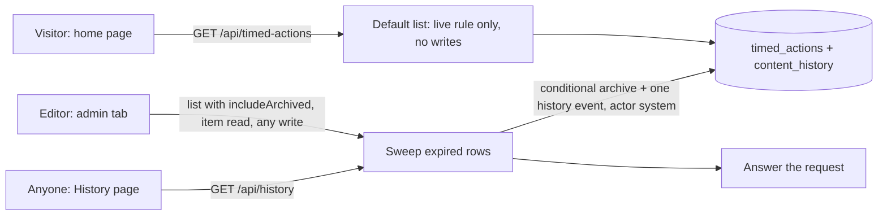

# Timed actions

**Status:** In Review
**Owner:** Jared B.
**Last updated:** 2026-11-13
**Related:** none (the repo has no tracker); design review notes are summarised in [Appendix D](#d-references)

---

## 1. Overview / business context

### 1.1 Problem statement

1. Each goal has one free-text "Actions" field. Asks with a deadline (for example "Comment on the Murphy Crossing infill station study by Nov. 30, 2026") sit in that text beside standing advice and stay on the public page after the deadline until an editor remembers to remove them.
2. A visitor cannot tell a deadline ask from standing advice, so the asks that most need attention get the least.
3. A deadline ask usually has a place to act (a comment form, a meeting address). The free text can carry a bare URL but not a labelled button or a location.

**Spec category:** Feature. It adds a new kind of content with its own lifecycle; nothing existing is migrated or replaced.

### 1.2 Business / customer outcome

- **Visitors** see deadline asks as a distinct, dated call to act under the goal they support, with a direct way to act, and never see one after its deadline.
- **Editors** (two people today) enter a deadline once and never have to come back to clean up.
- **Success is measured by:** no expired ask visible on the public page at any time, and no manual edit needed when a deadline passes.

### 1.3 Dependencies & assumptions

- **Depends on:** Google Maps' public search URL for the location button.
- **Assumes:** editors are a small set of trusted people signed in through Cloudflare Access; deadlines are whole calendar days in Atlanta time; a deadline ask belongs to exactly one goal.
- **Risks if wrong:** if deadlines ever need a time of day, the date-only field has to change shape. If asks ever need to span goals, the one-goal link has to become a list.

### 1.4 Tenets / constraints

- **The public page is correct without background work.** Whether an ask is shown is decided when the page is read, never by a job having run.
- **History is append-only.** Every content change, including an automatic one, is one event in the existing log, and the log's rows are never updated or deleted.
- **Names written to history are permanent.** Anything stored in the log cannot be renamed later, so it must be chosen to stay unambiguous.
- **The public API only grows.** Existing routes keep their shapes. The one widening of an existing shape, in the history feed, is called out in [4.3.4](#434-api).
- **Standing advice is untouched.** The existing free-text field keeps its content, storage and behavior.

---

## 2. Goals

**Goal 1 — Deadline asks are visible and actionable**
As a visitor, I want a deadline ask shown under its goal with its deadline and a way to act, so that I can act before it closes.
**Success signal:** a live ask appears under its goal with its tag and buttons on desktop and phone.

**Goal 2 — Nothing outlives its deadline**
As a visitor, I want asks to disappear when their last day ends in Atlanta, so that I never follow a dead call to action.
**Success signal:** an ask whose last day was yesterday is absent from the public page and the default API list, whether or not anyone has opened the admin or History page since.

**Goal 3 — Expiry is on the record**
As a reader of the History page, I want an automatic expiry recorded like a manual archive, so that the log explains why something left the site.
**Success signal:** each expired ask has exactly one `archive` event credited to `system`.

**Goal 4 — Editors enter it once**
As an editor, I want to add an ask with a description, optional link, optional location and last day, so that I do not have to return when it lapses.
**Success signal:** an editor creates, edits, archives and restores an ask from the admin page without touching anything else.

---

## 3. Out of scope

- **Asks without a deadline.** Those stay in the goal's free-text field, whose column is retitled "Ongoing actions".
- **A time of day or a start date.** An ask is live from creation through the end of its last day.
- **A details view behind the banner.** The banner's buttons are the whole interaction.
- **Re-checking the deadline in a tab left open past midnight.** The next page load is correct; a stale tab is accepted.
- **A scheduled job.** See [Appendix A](#a-alternatives-considered).
- **Refactoring how projects and goals are stored or served.** The new type reuses shared helpers and leaves both alone.
- **Fixing unrelated defects found during design review.** They are listed in [Appendix C](#c-operational-runbook-notes) to be filed separately.
- **A form-based admin editor.** The new type uses the existing JSON editor.

---

## 4. Proposed solution

### 4.1 Summary

A new content type, called "Action" in the admin and `timed_action` everywhere it is stored or served, with its own table, API routes and admin tab. The public page shows a live action as a slim amber banner under its goal. "Live" is a pure rule evaluated on every read (not archived, last day not past in Atlanta, goal not archived), so the page cannot show an expired ask. An expired row is archived for real, with a history event credited to `system`, by a guarded sweep that runs before the History page, the admin list, a single-item read or any write answers. This beats a scheduled job, which the current Cloudflare adapter cannot host without replacing the Worker entry and the deploy command.

### 4.2 Diagram



### 4.3 Component designs

#### 4.3.1 Storage and migration

**Responsibility:** hold timed actions and let the history log record them.

**Interfaces:** one new migration, `migrations/d1/0004_timed_actions.sql`; `scripts/check-d1-schema.mjs`.

```sql
CREATE TABLE IF NOT EXISTS timed_actions (
  id TEXT PRIMARY KEY,
  payload_json TEXT NOT NULL CHECK (json_valid(payload_json)),
  is_archived INTEGER NOT NULL DEFAULT 0 CHECK (is_archived IN (0, 1)),
  archived_at TEXT,
  archived_by TEXT,
  created_at TEXT NOT NULL,
  created_by TEXT NOT NULL,
  updated_at TEXT NOT NULL,
  updated_by TEXT NOT NULL,
  CHECK (json_type(payload_json, '$.expires_on') = 'text')
);

CREATE INDEX IF NOT EXISTS idx_timed_actions_archive_state
  ON timed_actions (is_archived, updated_at DESC);
```

The history table today only accepts `'project'` and `'goal'` as `entity_type`. SQLite cannot alter a CHECK, so the same migration rebuilds `content_history` in this order:

```sql
ALTER TABLE content_history RENAME TO content_history_old;

CREATE TABLE content_history (
  id TEXT PRIMARY KEY,
  entity_type TEXT NOT NULL,
  entity_id TEXT NOT NULL,
  action TEXT NOT NULL CHECK (action IN ('create', 'update', 'archive', 'restore')),
  actor TEXT NOT NULL,
  timestamp TEXT NOT NULL,
  before_json TEXT CHECK (before_json IS NULL OR json_valid(before_json)),
  after_json TEXT CHECK (after_json IS NULL OR json_valid(after_json))
);

INSERT INTO content_history
  SELECT id, entity_type, entity_id, action, actor, timestamp, before_json, after_json
  FROM content_history_old ORDER BY rowid;

DROP TABLE content_history_old;

-- then recreate idx_content_history_entity, idx_content_history_timestamp,
-- trg_content_history_immutable_update and trg_content_history_immutable_delete
-- exactly as in 0001
```

**Callouts:**

- **Dropping a table drops its indexes and triggers silently.** A rebuild that forgets to recreate the two immutability triggers leaves the log deletable. The order above was run against in-memory SQLite during review and left working triggers and clean stored SQL; re-verify on local D1 and staging.
- **Create the new table under its final name.** Building `content_history_new` and renaming it stores the name quoted, which fails the schema check's `create table content_history` match.
- **The `entity_type` CHECK is removed on purpose.** Every insert binds a typed code literal, and keeping the list in the table would force another rebuild of the audit log for any future type. `NOT NULL` stays, and the CHECK on the `action` verb stays.
- **Schema check changes:** replace the hard-coded `entity_type ... check (...)` line with the fragment `entity_type text not null, entity_id text not null` (adjacency proves no CHECK sits between them), keep the other `content_history` lines, and add `timed_actions` and its index.
- **A failed D1 migration file rolls back as a whole**, so a half-rebuilt log is not a reachable state.
- **Timed actions have no seed data.** `ensureSeeded` and `data/content/` need no change.
- **Backups need no change;** the export covers new tables.

**Open questions:** none. The owner confirmed removing the `entity_type` CHECK, rather than widening its list, on 2026-11-13.

#### 4.3.2 Record shape and validation

**Responsibility:** define what a timed action is and reject anything else.

**Interfaces:** Zod schemas in `src/lib/server/content/validators.ts`; the `TimedAction` type in `src/types/content.ts`; `ContentEntityType` widens to include `'timed_action'`.

```json
{
  "id": "ta-k3f9x2ab",
  "goal_id": "regional-beltline-rail",
  "description": "Comment on the Murphy Crossing infill station study.",
  "link": {
    "label": "Submit a comment",
    "url": "https://beltline.org/learn/current-projects/murphy-crossing-infill-station/"
  },
  "location": { "label": "Murphy Crossing site", "address": "1050 Murphy Ave SW, Atlanta, GA" },
  "expires_on": "2026-11-30",
  "provenance": {}
}
```

- `expires_on` is the **last day the action is shown**, as a calendar date in `America/New_York`.
- `link` and `location` are each an object or `null`. The stored record always carries both keys.
- Limits (builder may tune): `description` 1–300 characters, each `label` 1–40, `address` 1–200.

**Callouts:**

- **The schema is strict.** Unknown keys are rejected, so a misspelled `locaton` is a 400 and not a silently missing button.
- **The admin posts back what it read,** so the update schema must tolerate exactly what a response contains beyond the editable fields. Responses carry `id`, `provenance`, and the three archive fields, as the other types do. The admin strips the archive fields before saving; the existing forbidden-field check rejects them from any other client. The update schema accepts `id` only when it equals the path id.
- **`provenance` in a request body is accepted and ignored.** Responses rewrite `created_by` and `updated_by` to display names (`applyProfileMapToEntity`), and under replace semantics a client copy would otherwise be persisted. The server keeps the stored provenance and sets `updated_at` and `updated_by` itself.
- **Add no new derived fields to responses** (no `expired` or `live` flag); the strict schema would reject them on the way back in.
- **`link.url` uses `z.httpUrl()`.** Plain `z.string().url()` in the installed Zod accepts `javascript:` and `data:` addresses, and Svelte does not sanitise `href`.
- **`expires_on` uses `z.iso.date()`,** which rejects impossible dates such as `2026-02-30`.
- **Date window:** on create, and on update when the value changes, `expires_on` must be today (Atlanta) or later and at most 366 days out. An unchanged past date on an archived record is accepted, so an editor can fix a typo in an archived record's text.
- **`goal_id` must name an existing, unarchived goal** on create, on restore, and on update when it changes. It is never checked inside archive or the sweep, or an action whose goal was removed could never be archived.
- **Ids are generated by the server** as `ta-` plus eight random lowercase letters and digits. A create body that includes `id` is rejected. Every action ends its life archived and archived ids are never reused, so editor-typed slugs would collide.

**Open questions:** none.

#### 4.3.3 Service module

**Responsibility:** own the live rule, the sweep, and create, update, archive and restore for timed actions.

**Interfaces:** a new module beside `service.ts` in `src/lib/server/content/`, exposed as `timedActionStore` in `stores.ts`; reads and writes `timed_actions` and `content_history`; called by the routes and by `listHistory`.

**The live rule** is one pure function, shared by server and browser (place it under `src/utils/`): an action is live when it is not archived, `expires_on` is today or later in `America/New_York`, and its goal exists and is not archived. Compute "today in Atlanta" with `Intl.DateTimeFormat` and the named zone, which is correct across daylight-saving changes. The function takes the current time as a parameter so tests can set it.

**The sweep** finds rows with `is_archived = 0` and `json_extract(payload_json, '$.expires_on')` before today in Atlanta, and for each one, in a single batch:

1. inserts the history event only `WHERE EXISTS` an unarchived row with that id, then
2. updates the row to archived only `WHERE id = ? AND is_archived = 0`.

Two overlapping sweeps then write one event, not two. The event is a normal `archive` with actor `system` and the sweep's own timestamp; the record's `expires_on` in the event payload shows when it actually lapsed.

**Where the sweep runs:** before answering the list when `includeArchived` is true, the single-item read, every timed-action write, and `listHistory`. **Not** in the default public list.

| Operation                    | Behavior                                                                                                                                                                                    |
| ---------------------------- | ------------------------------------------------------------------------------------------------------------------------------------------------------------------------------------------- |
| List, default                | Pure read. Returns only live actions. No writes.                                                                                                                                            |
| List, `includeArchived=true` | Sweep, then return every row.                                                                                                                                                               |
| Get by id                    | Sweep, then return the row (archived or not), as the other types do.                                                                                                                        |
| Create                       | Sweep, validate, generate id, insert with a `create` event.                                                                                                                                 |
| Update                       | Sweep, then **replace**: the body must be the full record shape. A partial body is a 400. An omitted `link` or `location` is stored as `null`. Archive state is never changed by an update. |
| Archive                      | Sweep, then archive. If the row is already archived, return it and write no event.                                                                                                          |
| Restore                      | Sweep, then 409 if `expires_on` is past or the goal is missing or archived; otherwise restore with a `restore` event.                                                                       |

**Callouts:**

- **The sweep must never fail its caller.** Wrap it in try/catch and log. Otherwise a problem in the sweep would take down `/api/history` and the admin page's combined load.
- **Await the sweep; do not defer it.** The callers exist precisely so the answer reflects the archive.
- **Update replaces because the existing merge cannot remove a field.** The admin saves its whole editor JSON as a PATCH, and the project and goal services merge it over the stored record, so a deleted key keeps its old value. For this type that would leave a removed address public.
- **Extending the date on an expired action does not publish it.** The sweep archives it first, the update then succeeds, and the record stays archived until restored. The admin says so (see [4.3.6](#436-admin-editor)).
- **Missing table:** while the migration has not been applied, reads treat an error matching `no such table: timed_actions` as an empty list and writes return 503. Do not reuse `isMissingTableError`; its pattern also matches any `SQLITE_ERROR` and would hide real faults.
- **Reusable as they stand:** `getDb`, `SELECT_ENTITY_COLUMNS`, `INSERT_HISTORY_SQL`, `nowIso`, `cloneRecord`, `ensureProvenance`, `normalizeEntityForStorage`, `toHistoryJson`, `extractRunChanges`, `applyProfileMapToEntity`, `parseJsonObject`, `loadProfileMap`, `assertNoForbiddenWriteFields`, and the three handler factories. The per-type SQL constants, row finders and row mappers are specific to projects and goals; write new ones.
- **History ordering gets a tiebreak.** `listHistory` orders by `timestamp DESC` alone, so a sweep and a write in the same millisecond could swap. Add `, rowid DESC`.

**Open questions:** none.

#### 4.3.4 API

**Responsibility:** serve timed actions publicly and accept edits from authenticated editors.

**Interfaces:**

- `GET /api/timed-actions` (public; `?includeArchived=true` returns all)
- `POST /api/timed-actions` (`content:edit`)
- `GET /api/timed-actions/{id}` (public)
- `PATCH /api/timed-actions/{id}` (`content:edit`, full-record replace)
- `DELETE /api/timed-actions/{id}` (`content:archive`)
- `POST /api/timed-actions/{id}/restore` (`content:archive`)

Built from `makeCollectionHandlers`, `makeItemHandlers` and `makeRestoreHandler`, with the same `{ data }` and `{ data, meta: { count } }` envelopes, and registered in `src/lib/server/openapi/spec.ts`.

**Callouts:**

- **`GET /api/history` accepts `entityType=timed_action`.** Today any value other than `project` or `goal` is ignored and everything is returned.
- **The history feed widens an existing published shape.** The OpenAPI spec publishes `entity_type` as a closed `project | goal` enum, in the event schema and in the query parameter (`spec.ts`, near lines 37 and 327). After this feature the unfiltered feed also returns `timed_action` events, and `actor` can be `system`. Update both enums.
- **Earlier values stay public in history.** Replacing a record removes an old link or address from the live record and the banner, but the previous value remains in that record's history events, and archived actions stay readable by id and with `includeArchived=true`. This is how projects and goals already behave and follows from the append-only log; it is accepted here, not solved.
- **Existing write protections apply unchanged:** the write rate limit and cross-origin check in `hooks.server.ts` key on the `/api/` prefix.

**Open questions:** none. The owner confirmed the six new routes and the history-feed widening on 2026-11-13; both are changes to the published API, which is on the ask-first list in `AGENTS.md`.

#### 4.3.5 Public page

**Responsibility:** show live actions under their goals.

**Interfaces:** `src/routes/+page.ts` loads `/api/timed-actions`; `src/components/svelte/GoalsTable.svelte` renders the banners.

```
┌──────────┬──────────────────────────────────────────────────────────────────┐
│ ACT NOW  │ Comment on the Murphy Crossing    [Submit a comment ↗]           │
│ (amber)  │ infill station study.             [📍 Murphy Crossing site]      │
│          │                                                  (Expires today) │
└──────────┴──────────────────────────────────────────────────────────────────┘
```

- **Placement:** nested under the goal, in the slot project cards use, above any project cards. Several actions under one goal are ordered by `expires_on`, soonest first.
- **Content:** the description, then a link button (the editor's label, opens the URL) when `link` is set, then a location button with a pin icon (the editor's label) when `location` is set. With neither, text only.
- **Location button target:** `https://www.google.com/maps/search/?api=1&query=` followed by the URL-encoded address. On a phone this hands off to the Maps app.
- **Tag:** "Expires today" on the last day; otherwise "Closes" plus the short date, for example "Closes Nov. 30".
- **No click-through.** Unlike a project card, the banner opens nothing.
- **Column heading:** all four tables' third column becomes "Ongoing actions", replacing both "Actions" and "Actions to take in support of the Goal". The matching `data-label="Actions"` values change too; they are the only label on phones, where the header row is hidden. The other headings stay as they are, including the longer "Status/Related Projects" and "Related Orgs" on the all-counties table.

**Callouts:**

- **The goals table is four near-identical copies** (regional and per-county, each with and without a selected county). Extract one snippet for a goal's row group first, as its own behavior-neutral change ([Ticket 1](#ticket-1--one-goal-row-snippet-in-the-goals-table)), then add the banner once. The snippet covers the body rows only; each table keeps its own header row.
- **The row groups differ in one visible way:** two of the four copies wrap org contact info in parentheses and two do not. Unify on parentheses everywhere. That is the only visible change in Ticket 1.
- **Phone layout names its row classes.** The narrow-width CSS lists `.goal-row` and `.project-row` explicitly; a new row class that is not added to those lists stays a table row inside a flex column and detaches from its goal.
- **A goal listed under two counties shows its banner in both sections,** because the goal itself is rendered in both.
- **A failed timed-actions fetch yields an empty list and must not set `usingFallback`.** Missing banners are not a reason to show the fallback-data notice.
- **Apply the live rule in the browser as well,** using the shared function, so a page rendered just before midnight and hydrated just after agrees with itself.
- **Accessibility:** the banner is ordinary content, not `role="alert"`. "Act now" and the tag are real text. Buttons are links with `target="_blank"` and `rel="noopener noreferrer"`; the pin icon is decorative.
- **Color:** amber is not in the palette. Add the token or tokens in `src/styles/global.css` and document them in `docs/design-tokens.md`; no hex literals in the component. Dark text on the amber fill must meet WCAG AA.

**Open questions:** none. The owner confirmed parentheses around org contact info in every table on 2026-11-13.

#### 4.3.6 Admin editor

**Responsibility:** let editors create, edit, archive and restore timed actions.

**Interfaces:** `src/routes/admin/+page.svelte`; the timed-actions routes.

- A third dataset tab labelled "Actions".
- **Starter template** for a new record: `goal_id`, `description`, `link` (with `label` and `url`), `location` (with `label` and `address`) and `expires_on`, with no `id`. `link` and `location` may be set to `null`.
- The list shows each action's last day.

**Callouts:**

- **The page assumes exactly two datasets** in about a dozen `dataset === 'project' ? … : …` expressions; a third tab would silently fall through to goals. Replace them with one lookup keyed by dataset (endpoint, label, template, list source).
- **The lookup keys must equal the stored `entity_type` values** (`project`, `goal`, `timed_action`). The "Recent Changes" list passes `event.entity_type` straight to the record selector.
- **New records of this type have no id.** The client-side "must include a non-empty id" check has to skip this type; after saving, the page already selects the record from the response's `data.id`.
- **Saving an archived action** shows: "Saved. This action is still archived; restore it to publish."
- **Restore errors must be readable.** A 409 from restore carries the reason (last day has passed, or the goal is archived); show it as given.
- **The admin list always loads with `includeArchived=true`,** so it is swept before it answers and never shows an expired action as active.

**Open questions:** none.

#### 4.3.7 History page

**Responsibility:** show timed-action events readably.

**Interfaces:** `src/routes/history/+page.svelte`.

**Callouts:**

- **Map entity types to labels:** Project, Goal, Timed action. The page currently prints the raw `entity_type` under a column that is itself headed "Action".
- **Update the intro sentence,** which says the log covers "project and goal edits".
- **`system` is a new actor value.** It has no profile, so it displays as written.

**Open questions:** none.

---

## 5. Implementation plan

Tickets are in dependency order. The repo has no tracker, so they are numbered.

### Ticket 1 — One goal-row snippet in the goals table

**User Story:**
As a contributor, I need the goal row group defined once so that a change to how a goal renders is made in one place.

**Acceptance Criteria (checkbox-ready):**

- **Rendering**
  - [ ] The four table bodies in `GoalsTable.svelte` render through one snippet
  - [ ] Regional and county tables look the same as before, except org contact info is in parentheses in all of them
  - [ ] Project cards still open the detail modal by click and by keyboard

**Callouts (implementation breadcrumbs, in dependency order):**

- **UI** (`src/components/svelte/GoalsTable.svelte`): blocks at roughly lines 185–275, 305–395, 425–515 and 544–634; the first and last are identical, and the middle two differ only in loop source and the contact-info parentheses.

**Rollout:**
**Test plan:** `GoalsTable` has no component test today. Write one first, against the current code, that a goal with a related project renders one goal row and one project card in each of the four table variants; then refactor and keep it green. Compare the page before and after by eye on desktop and phone widths.
**Legacy / migration handling:** none.

**Definition of done:** `npm run ci:gate` passes; no visual change other than the parentheses.
**Rollback / feature flag:** revert the PR.

### Ticket 2 — Migration for timed actions and the history log

**User Story:**
As an editor, I need the database to store timed actions and record their history so that the feature has somewhere to write.

**Acceptance Criteria (checkbox-ready):**

- **Schema**
  - [ ] `timed_actions` exists with its index and the `expires_on` type check
  - [ ] `content_history` accepts `entity_type = 'timed_action'`
  - [ ] Both immutability triggers and both history indexes exist after the migration; an `UPDATE` or `DELETE` on `content_history` still aborts
  - [ ] The history row count and contents are unchanged by the migration
- **Tooling**
  - [ ] `npm run schema:check` passes against a freshly migrated local database and asserts the new table, its index and the new `content_history` shape

**Callouts (implementation breadcrumbs, in dependency order):**

- **External / prerequisites**: the owner applies remote migrations; agents do not (`AGENTS.md` → Boundaries). Apply to production **before** Ticket 3 merges.
- **Database** (`migrations/d1/0004_timed_actions.sql`): the statement order in [4.3.1](#431-storage-and-migration) matters.
- **Tooling** (`scripts/check-d1-schema.mjs`): see the schema-check callout in 4.3.1.

**Rollout:**
**Test plan:** apply locally and run `schema:check`, `test:smoke` and `test:integration`; apply to the staging database and confirm the history row count before and after, then try a `DELETE FROM content_history` there and confirm it aborts. Staging is a database only; there is no staging site (see [6.1](#61-release-strategy)).
**Legacy / migration handling:** existing history rows are copied in `rowid` order. Export the production database first ([`docs/backup-retention-policy.md`](../backup-retention-policy.md)).

**Definition of done:** migration applied to staging and production; schema check green in CI.
**Rollback / feature flag:** the new table is inert if unused. Undoing the history rebuild means restoring from the pre-migration export.

### Ticket 3 — Timed-action service and API

**User Story:**
As an editor, I need to create and manage timed actions through the API so that the admin page and the public page have data to work with.

**Acceptance Criteria (checkbox-ready):**

- **Validation**
  - [ ] Unknown keys, a non-http(s) `link.url`, an impossible date, a past date, a date more than 366 days out, and a missing or archived `goal_id` are each rejected with a 400 that names the field
  - [ ] A create body containing `id` is rejected; the response carries a generated `ta-` id
- **Live rule**
  - [ ] The default list returns an action on its last day and omits it the next day, Atlanta time, on both sides of a daylight-saving change
  - [ ] The default list omits an action whose goal is archived and returns it again once the goal is restored
  - [ ] The default list performs no writes
- **Sweep**
  - [ ] Opening History, loading the admin list, reading one action, or any timed-action write archives every expired action first
  - [ ] Each expired action gets exactly one `archive` event with actor `system`, including when two sweeps overlap
  - [ ] A sweep failure is logged and the request still answers
- **Update, archive, restore**
  - [ ] Update replaces the record: an omitted `link` or `location` is stored as `null`; a partial body is a 400
  - [ ] Archiving an already-archived action writes no event
  - [ ] Restoring an expired action, or one whose goal is archived, is a 409 with a reason
- **API**
  - [ ] The six routes in [4.3.4](#434-api) behave as listed, with `content:edit` and `content:archive` enforced as for goals
  - [ ] `GET /api/history?entityType=timed_action` returns only timed-action events
  - [ ] The routes and schemas appear in `/api/openapi.json`
  - [ ] Before the migration is applied, reads return an empty list and writes return 503

**Callouts (implementation breadcrumbs, in dependency order):**

- **External / prerequisites**: Ticket 2 applied to production first.
- **Shared types** (`src/types/content.ts`): `TimedAction`; widen `ContentEntityType`.
- **Backend logic** (`src/lib/server/content/`): new module, new schemas in `validators.ts`, `timedActionStore` in `stores.ts`, sweep call and `rowid` tiebreak in `listHistory`. Expect about 250 lines for the module, 40 in validators and 150 of tests.
- **Shared rule** (`src/utils/`): the pure live-rule function with an injectable clock.
- **API** (`src/routes/api/timed-actions/`, `src/routes/api/history/+server.ts`, `src/lib/server/openapi/spec.ts`).

**Rollout:**
**Test plan:** two layers, with no new dependency.

- **Unit (Vitest):** everything that needs no database: the live rule with a set clock (last day, day after, both daylight-saving weekends), the validators, id generation, and handler auth and status codes against a fake store. The Vitest setup stubs `cloudflare:workers` with an empty `env`, so `getDb()` throws there and service code cannot be unit-tested as it stands.
- **Integration (local Wrangler worker, `scripts/integration-content-api.mjs` and the smoke script):** everything that touches D1: create, list, replace-on-update, archive no-op, restore 409, and the sweep writing exactly one `system` event. The API rejects past dates, so insert the expired rows with a local `wrangler d1 execute`.
  **Legacy / migration handling:** none beyond Ticket 2.

**Definition of done:** `npm run ci:gate:full` passes; the routes answer on production with an empty list.
**Rollback / feature flag:** revert the PR; the table keeps any rows and nothing reads them.

### Ticket 4 — Banner, admin tab and History labels

**User Story:**
As a visitor, I need to see live actions under their goals, and as an editor I need to manage them in the admin page, so that the feature is usable end to end.

**Acceptance Criteria (checkbox-ready):**

- **Public banner**
  - [ ] A live action renders under its goal, above project cards, in all four table variants and at phone width
  - [ ] Link only, location only, both, and neither each render as described in [4.3.5](#435-public-page)
  - [ ] The location button opens the Google Maps search URL for the address in a new tab
  - [ ] The tag reads "Expires today" on the last day and "Closes" plus the short date before it
  - [ ] Several actions under one goal are ordered soonest first
  - [ ] A failed timed-actions fetch shows no banners and no fallback notice
- **Headings**
  - [ ] The third column reads "Ongoing actions" in every table and in the phone layout's labels
- **Admin**
  - [ ] An "Actions" tab lists, creates, edits, archives and restores timed actions
  - [ ] "New" opens the starter template and saves without an id
  - [ ] Projects and goals still save to their own endpoints
  - [ ] Saving an archived action shows the "still archived" message; a refused restore shows the reason
- **History**
  - [ ] Events show "Project", "Goal" or "Timed action"; the intro sentence mentions actions

**Callouts (implementation breadcrumbs, in dependency order):**

- **External / prerequisites**: Tickets 1 and 3 merged.
- **UI** (`src/routes/+page.ts`, `src/components/svelte/GoalsTable.svelte`): add the new row class to the narrow-width CSS lists.
- **Design tokens** (`src/styles/global.css`, `docs/design-tokens.md`): the amber token or tokens.
- **Admin** (`src/routes/admin/+page.svelte`): dataset lookup replacing the two-way ternaries.
- **History** (`src/routes/history/+page.svelte`).

**Rollout:**
**Test plan:** component tests for the four banner variants, the two tag states and ordering; an admin test that each dataset saves to its own endpoint; manual check on the local dev server at desktop and phone widths, with rows inserted for "closes later", "expires today" and "expired yesterday". After the merge deploys, repeat the check on production with one real action, including a tap on the location button on a phone.
**Legacy / migration handling:** after release, move the Murphy Crossing comment ask out of the Beltline goal's free text and into a timed action (a content edit, done by an editor).

**Definition of done:** `npm run ci:gate` passes; locally, the three inserted rows show "Closes" plus a date, "Expires today", and nothing, and History shows a `system` archive for the expired one; on production, a real action appears under its goal.
**Rollback / feature flag:** revert the PR; the API and data remain.

---

## 6. Rollout plan

### 6.1 Release strategy

Four merges in order, each deployable alone, because every merge to `main` deploys production:

1. Ticket 1 merges (no data, one small visible change).
2. Ticket 2: export production, apply the migration to staging, verify, apply to production, then merge the PR.
3. Ticket 3 merges (API live, nothing shows it yet).
4. Ticket 4 merges (feature visible).

The migration must reach production before Ticket 3's code. If the order slips, the code degrades to "no banners" rather than failing.

**There is no staging site.** `wrangler.jsonc` defines a staging database but no reachable staging Worker, and pull-request branches only upload a Worker version without deploying it. Staging therefore verifies the migration only. Interface changes are verified on the local dev server before merge and on production after it.

**Target date:** none. The tickets are implemented one after another in the order above, without a deadline. The motivating ask (the Murphy Crossing comment period) closes Nov. 30, 2026; the feature may or may not be live by then, and the ticket order does not change to chase it.

### 6.2 Operational readiness

- **Owner on release day:** the repo owner, who also runs the remote migration.
- **What to watch:** Workers logs for the sweep's failure log line; the History page for unexpected `system` events.
- No new dashboards or alerts; the site has none today and this does not change that.

### 6.3 Rollback triggers

- **Migration:** the history row count differs before and after, or a test `DELETE` on `content_history` succeeds. Restore from the export.
- **Ticket 3:** `/api/history` or the admin load starts failing. Revert the PR.
- **Ticket 4:** the goals table renders wrongly at any width, or projects or goals save to the wrong endpoint. Revert the PR.

---

## 7. Appendix

### A. Alternatives considered

| Option                                            | Pros                                     | Cons                                                                                                                                                                                                            | Why not chosen                                                 |
| ------------------------------------------------- | ---------------------------------------- | --------------------------------------------------------------------------------------------------------------------------------------------------------------------------------------------------------------- | -------------------------------------------------------------- |
| Cloudflare Cron Trigger that archives at midnight | Archive time is close to the real expiry | adapter-cloudflare 8 emits a fetch-only Worker and rewrites the entry file on each build, so it needs a wrapper entry and a different deploy command; cron runs in UTC, so one schedule is a day late in winter | Highest cost and risk for a timestamp nobody needs to be exact |
| Sweep on every public read                        | Archive happens sooner                   | The hottest path performs writes                                                                                                                                                                                | The public page never needs the archive flag to be right       |
| Store actions inside the goal's payload           | No new table or routes                   | No per-action history, archive or restore; every edit rewrites the goal                                                                                                                                         | Loses the History requirement                                  |
| Reuse projects with an end date                   | No new type                              | Projects are not asks; statuses, modal and sources do not fit                                                                                                                                                   | Wrong shape                                                    |
| Separate history table for the new type           | No rebuild of the audit log              | Splits History in two                                                                                                                                                                                           | One log is a tenet                                             |
| Real `expires_on` and `goal_id` columns           | Simpler SQL                              | A second source of truth beside the payload; table shape diverges from the other types                                                                                                                          | No correctness gain at this size                               |
| Editor-typed ids                                  | Matches projects and goals               | Every action ends archived and ids are never reused, so slugs collide                                                                                                                                           | Generated ids avoid it                                         |
| Stored type named `action`                        | Matches the admin label                  | The log already has an `action` column for the verb, and the name could never be changed                                                                                                                        | Permanent ambiguity                                            |

### B. Reference tables / mappings

| Where                 | Name used                                                        |
| --------------------- | ---------------------------------------------------------------- |
| Admin tab             | Actions                                                          |
| Public banner label   | Act now                                                          |
| Goal free-text column | Ongoing actions (heading only; the stored field stays `actions`) |
| Database table        | `timed_actions`                                                  |
| History `entity_type` | `timed_action`                                                   |
| API                   | `/api/timed-actions`                                             |
| TypeScript            | `TimedAction`                                                    |
| History page label    | Timed action                                                     |
| Automatic actor       | `system`                                                         |

### C. Operational runbook notes

Remote migration commands are in the README ("Cloudflare / D1 Operations"); backup and restore are in [`docs/backup-retention-policy.md`](../backup-retention-policy.md).

Defects found during design review that this spec does **not** fix; file each separately:

- Project, goal and org link fields accept `javascript:` and `data:` URLs (`z.string().url()` in `validators.ts`).
- An update that overlaps an archive of the same project or goal can undo the archive with no `restore` event, because update rewrites the archive columns from a stale read.
- Archiving or restoring a project or goal twice writes duplicate history events; only the admin buttons prevent it.
- Project and goal updates cannot remove a field, because the patch is merged over the stored record.
- `isMissingTableError` matches any `SQLITE_ERROR`, not only a missing table.

### D. References

- Design conversation with the owner, 2026-11-13: visitor behavior, naming, History requirement, one goal per action.
- Adversarial design review, 2026-11-13 (two rounds, read-only against this repo at `9cd98fc`): source of the adapter, migration, validation and admin findings above.
- [adapter-cloudflare docs](https://svelte.dev/docs/kit/adapter-cloudflare); [Cloudflare Cron Triggers](https://developers.cloudflare.com/workers/configuration/cron-triggers/); [Google Maps URLs](https://developers.google.com/maps/documentation/urls/get-started).
